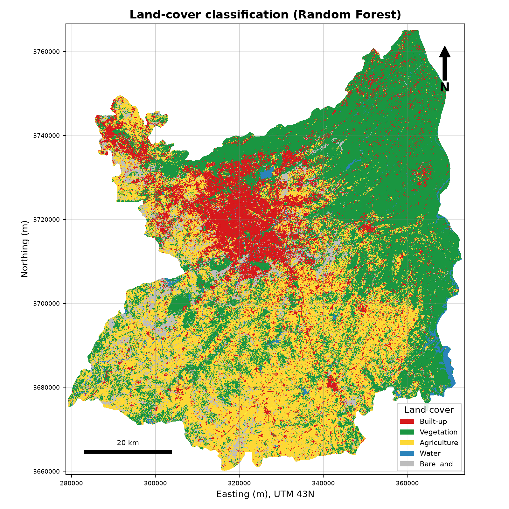
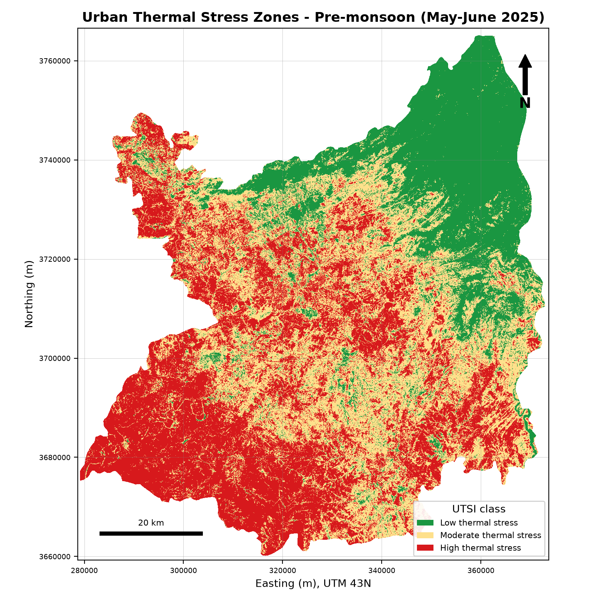

# Urban Thermal Environment and Vegetation Dynamics in Islamabad–Rawalpindi

A multi-sensor digital image processing project for the Islamabad–Rawalpindi Twin Cities (Pakistan), using Landsat 8/9 and Sentinel-2 imagery, Google Earth Engine and Python. It was prepared as a final project for the course Advanced Digital Image Processing.

**Research question:** How do vegetation, built-up surfaces and land-cover patterns influence the spatial distribution of land surface temperature (LST) in Islamabad and Rawalpindi?

## Study design

- **Area:** Islamabad District and Rawalpindi District (about 6,123 km²), FAO GAUL 2015 boundaries
- **Periods:** pre-monsoon (May–June 2025) and post-monsoon (September–October 2025)
- **Data:** Landsat 8/9 Collection 2 Level-2, Sentinel-2 SR Harmonized, ESA WorldCover v200, Dynamic World, MODIS MOD11A2
- **Grid:** 30 m, UTM Zone 43N (EPSG:32643)
cd C:\DIP_Project\DIP_Twin_Cities_Project
$url = "https://rameennaeemgeo.github.io/DIP-Twin-Cities-Urban-Thermal/"
$lines = Get-Content README.md
$new = @($lines[0], "", "**Live dashboard:** [$url]($url)", "") + $lines[1..($lines.Count-1)]
$new | Set-Content -Encoding UTF8 README.md
git add README.md
git commit -m "Add live dashboard link to README"
git push
gh repo edit rameennaeemgeo/DIP-Twin-Cities-Urban-Thermal --homepage $url --description "Urban thermal environment and vegetation analysis of Islamabad-Rawalpindi using Landsat, Sentinel-2 and Google Earth Engine"

## Methods

Cloud masking, radiometric scaling and median compositing; contrast stretching, histogram equalization, median and Gaussian filtering; NDVI, NDBI and NDWI; LST from the Landsat Level-2 thermal product; Random Forest land-cover classification (5 classes); seasonal image differencing; threshold segmentation with morphological opening; a project-defined Urban Thermal Stress Index (UTSI) with a weight-sensitivity test; Pearson and Spearman correlation and linear regression; Landsat vs MODIS comparison.

## Key results

| Result | Value |
|---|---|
| Mean LST, pre-monsoon / post-monsoon | 43.6 °C / 32.4 °C (mean change −11.2 °C) |
| LST vs NDVI (Pearson r) | −0.70 / −0.68 |
| LST vs NDBI (Pearson r) | 0.79 / 0.76 |
| Land cover | Vegetation 42.3%, agriculture 34.1%, built-up 14.7%, bare land 7.5%, water 1.4% |
| Classification accuracy | 91.5% overall, kappa 0.893 (preliminary, see limitations) |
| Landsat vs MODIS LST | r = 0.93 / 0.95, Landsat 5.7–8.7 °C warmer |

The highest thermal stress is found mainly on dry agricultural and bare land of the southern plain. Built-up land has almost the same mean LST in the two districts, so most of the difference between Islamabad and Rawalpindi comes from land-cover mix.

## Repository structure

- `11_Scripts/` – all Python scripts, in the order they are run
- `08_Final_Maps/`, `09_Charts/`, `03_Preprocessed_Images/Enhanced_Images/` – maps, charts and enhancement figures
- `07_Statistics/Tables/` – statistical tables (CSV)
- `06_Classification/`, `05_Thermal_Analysis/`, `01_Study_Area/` – classification outputs, thermal stress outputs and district boundaries
- `10_Research_Report/` – project report
- `Dashboard.html` – interactive dashboard of the results

## Reproduce

1. Install Python 3.12 and the libraries: `pip install earthengine-api geemap numpy pandas matplotlib seaborn rasterio geopandas scikit-learn scipy shapely python-docx`
2. Run `earthengine authenticate`, then replace the Earth Engine project ID in the scripts with your own.
3. Run the scripts in `11_Scripts/` in numerical order. Scripts 02 and 04 export GeoTIFFs to Google Drive; download them into `02_Raw_Data/` before running scripts 03 and later.

The GeoTIFF rasters are not stored in this repository because of their size.

## Limitations

- The 91.5% classification accuracy is measured against pixels where ESA WorldCover and Dynamic World agree. It is not an independent accuracy, and independent validation points are still needed.
- Landsat LST is systematically warmer than MODIS LST, so absolute temperatures should be used with caution.
- District boundaries include large rural and hill areas, and elevation effects are not separated.
- LST is a surface temperature, not air temperature, and the results are associations, not proof of cause.

## Author

Rameen Naeem, BS Geoinformatics, PMAS-Arid Agriculture University, Rawalpindi
